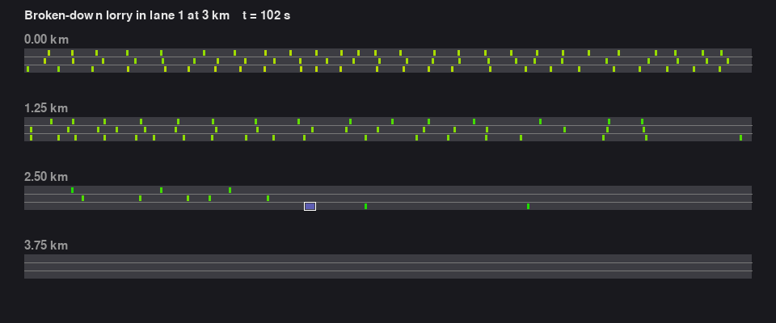
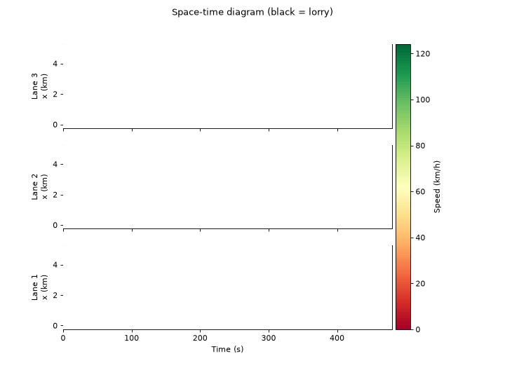
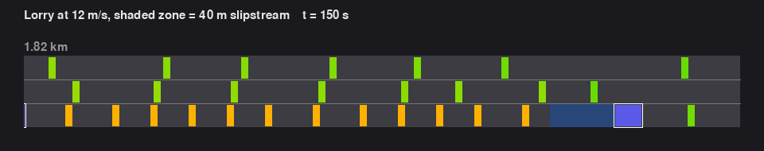
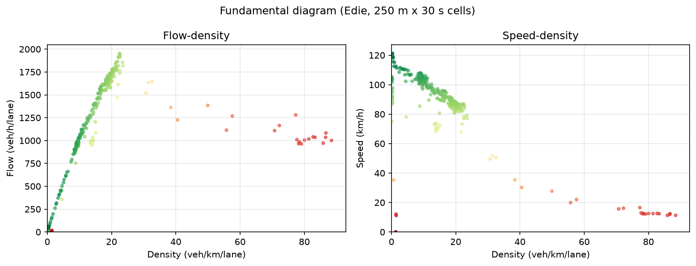
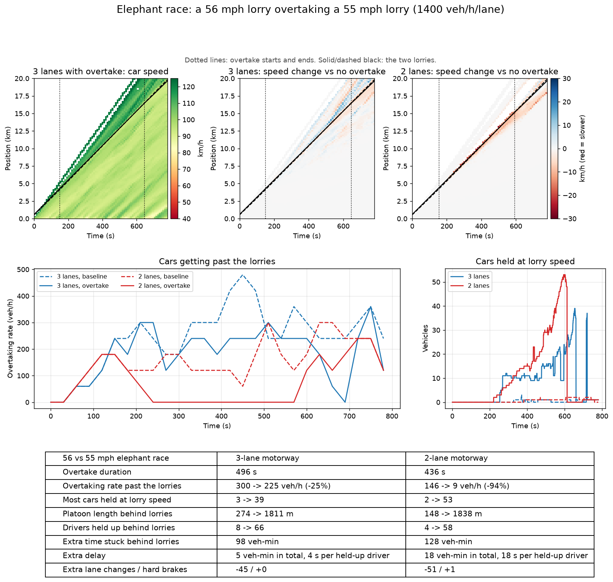
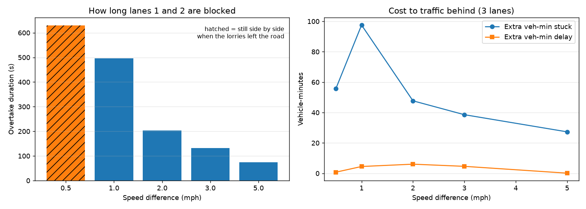
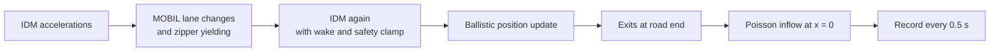

<div align="center">

# motorway-flow-sim

**Agent-based motorway traffic, where every jam comes from individual drivers.**

[](https://github.com/JFrusher/motorway-flow-sim/actions/workflows/ci.yml)

[](LICENSE)
[](https://github.com/psf/black)



</div>

A lorry breaks down in lane 1. Nobody tells the simulation to form a queue. Each driver follows
the car ahead with the Intelligent Driver Model, decides on lane changes with MOBIL, and zips
into the next lane when they reach the obstruction. The queue, the shockwave that runs back up
the motorway and the drop in capacity all come out of those local rules.

The idea comes from fluid dynamics. A lorry on a motorway behaves a lot like a backward-facing
step in a CFD channel: a bluff body with a low-pressure wake behind it. Congestion fronts travel
like shock waves in a compressible flow. This project models that at the level of single
vehicles. It includes a slipstream that lets cars close up and accelerate harder while they draft
a moving lorry.

## Contents

- [What it shows](#what-it-shows)
- [Quick start](#quick-start)
- [Scenarios](#scenarios)
- [Elephant races](#elephant-races)
- [How it works](#how-it-works)
- [Analytics](#analytics)
- [Project layout](#project-layout)
- [Contributing](#contributing)
- [References](#references)

## What it shows

<table>
<tr>
<td width="50%" valign="top">

**Shockwave behind a breakdown**



The space-time diagram fills in as time passes. The red band growing back from 3 km is the queue.
Its upper edge moves upstream while the cars inside it move forward.

</td>
<td width="50%" valign="top">

**Drafting a slow lorry**



The camera follows a lorry doing 12 m/s. Cars in the shaded zone get the slipstream bonus and
sit closer. Then they pull out once lane 2 has a gap that MOBIL accepts as safe.

</td>
</tr>
</table>

The fundamental diagram from the breakdown run has the textbook shape: a free-flow branch peaking
near 2,000 veh/h/lane and a congested branch at roughly 1,000–1,300 veh/h/lane. The gap between
them is the capacity drop.

<p align="center">

</p>

## Quick start

```bash
git clone https://github.com/JFrusher/motorway-flow-sim.git
cd motorway-flow-sim
pip install -r requirements.txt

python scripts/run_simulation.py            # headless run of the default scenario
python scripts/run_simulation.py --render   # live Pygame window (space pauses, esc quits)
```

A headless run writes to `output/`:

| File | Contents |
|------|----------|
| `trajectories.csv` | `t, id, lane, x, v, a, is_lorry` for every vehicle, sampled every 0.5 s |
| `space_time.png` | Position against time, one panel per lane, coloured by speed |
| `fundamental_diagram.png` | Flow-density and speed-density from Edie's definitions |

<details>
<summary><b>All CLI options</b></summary>

```text
python scripts/run_simulation.py [--config FILE] [--render] [--duration S]
                                 [--seed N] [--output DIR] [--no-plots]

python scripts/generate_plots.py --input output/trajectories.csv --config config.yaml
python scripts/elephant_race.py  [--output DIR] [--workers N]
python scripts/make_media.py     # rebuild the GIFs and figures in docs/
```

</details>

## Scenarios

| Config | Lorry | What to watch |
|--------|-------|---------------|
| [`config.yaml`](config.yaml) (the default) | Stationary in lane 1 at 3 km | Zipper merge, a queue growing upstream in lanes 1 and 2, capacity drop |
| [`config_moving_lorry.yaml`](config_moving_lorry.yaml) | 12 m/s in lane 1, plus 5% lorry traffic | Moving bottleneck, a drafting platoon, overtakers slowing lanes 2 and 3 |

Any field of [`SimConfig`](motorway/config.py) can be set in YAML: road length, lanes, inflow,
driver mix, wake strength, MOBIL thresholds. The loader rejects unknown keys and unsafe values
such as a timestep above 0.1 s.

```yaml
# my_scenario.yaml
inflow: 5400            # veh/h across all lanes
lorry_fraction: 0.1     # share of lane-1 arrivals that are lorries
profile_mix: {aggressive: 0.4, normal: 0.5, cautious: 0.1}
```

> [!TIP]
> [`notebooks/exploration.ipynb`](notebooks/exploration.ipynb) sweeps driver heterogeneity and
> lorry density and plots how mean speed and exit rate respond.

## Elephant races

British drivers call it an elephant race: one HGV overtaking another, both on speed limiters that
differ by a mile an hour or so. For minutes on end the two lorries fill lanes 1 and 2 at about
55 mph.

[`scripts/elephant_race.py`](scripts/elephant_race.py) scripts exactly that. Two lorries in
lane 1 do 56 and 55 mph. After 150 s the faster one pulls out, using the same safety check as
MOBIL, and pulls back in once it is 15 m clear. Each run is paired with a baseline that uses the
same seed and keeps both lorries in lane 1. The two runs see the same arrivals and the same
drivers, so the differences come from the overtake alone. Demand is 1,400 veh/h/lane on a 20 km
road.

```bash
python scripts/elephant_race.py   # 12 runs in parallel, a few minutes
```

<p align="center">

</p>

| 56 vs 55 mph | 3-lane motorway | 2-lane motorway |
|---|---|---|
| Time the overtake takes | 8 min 16 s | 7 min 16 s |
| Cars getting past the lorries | 300 → 225 veh/h (−25%) | 146 → 9 veh/h (−94%) |
| Most cars held at lorry speed at once | 3 → 39 | 2 → 53 |
| Platoon behind the lorries | 274 m → 1.8 km | 148 m → 1.8 km |
| Drivers held up | 8 → 66 | 4 → 58 |
| Extra time spent stuck behind | 98 vehicle-minutes | 128 vehicle-minutes |
| Extra delay | 5 vehicle-minutes, about 4 s per held-up driver | 18 vehicle-minutes, about 18 s per held-up driver |

On a two-lane road the overtake shuts the carriageway: almost nobody gets past for over seven
minutes. With three lanes, lane 3 still lets traffic through, but eight times as many drivers end
up stuck at lorry speed.

At this demand the queue never stops moving. Held-up drivers are doing 55 mph instead of about
70, so each one loses seconds rather than minutes. The cost shows up in how many people get
trapped and for how long, not in a jam.

The speed gap matters more than intuition suggests. A 1 mph difference makes the overtake take
almost seven times as long as a 5 mph one, and it traps more than three times as many
vehicle-minutes behind the pair. At 0.5 mph, the lorries were still side by side when they
reached the end of the 20 km road.

<p align="center">

</p>

The full figures are in [`docs/elephant_race/report.md`](docs/elephant_race/report.md) and
[`metrics.json`](docs/elephant_race/metrics.json). They include platoon growth rate, lane
changes, moves into the outside lane and hard-braking events.

<details>
<summary><b>How the impact is measured</b></summary>

- **Overtaking rate:** the net number of cars crossing the front of the leading lorry per hour,
  averaged over the overtake. This is the throughput of the moving bottleneck.
- **Held at lorry speed:** cars below the fast lorry's speed + 1 m/s, collected from the lorries
  upstream in any lane while consecutive cars are within 150 m.
- **Extra delay:** the difference in total time spent between the overtake run and its baseline.
  Total time spent counts vehicles on the road plus vehicles waiting to enter. Both runs have the
  same arrivals, so this difference is the delay the overtake caused within the run.
- **Hard braking:** a car crossing −3 m/s² counts as one event.

</details>

## How it works

Each 0.1 s step runs the same pipeline:



**Car following (IDM).** Each driver accelerates towards a desired speed and brakes to keep a
desired gap, which grows with speed and closing rate. All vehicles are evaluated in one
vectorised NumPy call.

**Lane changing (MOBIL).** A driver changes lane when the move improves their own acceleration by
more than a threshold, after subtracting a politeness-weighted cost to the cars behind. The change
must also be safe: nobody may have to brake harder than 4 m/s². A keep-left bias follows UK
motorway rules.

**Lorry slipstream.** Within 40 m behind a moving lorry, a follower's maximum acceleration goes up
and its desired headway comes down. The effect scales with the lorry's speed squared, because
drag scales with dynamic pressure. A parked lorry has no wake.

**Zipper merging.** Plain MOBIL deadlocks at a lane closure: a stopped car never finds a gap in a
90 km/h lane that IDM rates as safe. Drivers within 500 m of a blocked lane get a strong incentive
to leave it. If one still can't merge, the follower in the free lane slows down to let them in,
braking no harder than its comfortable rate.

**Driver mix.** Aggressive, normal and cautious drivers differ in desired speed, headway, braking
and politeness. Every driver's desired speed gets ±5% noise as well. Lorries are capped at 25 m/s
and stay in lane 1.

<details>
<summary><b>The maths</b></summary>

<br>

**IDM acceleration**

$$
\dot v = a\left[1-\left(\frac{v}{v_0}\right)^{4}-\left(\frac{s^*(v,\Delta v)}{s}\right)^2\right],
\qquad
s^*(v,\Delta v) = s_0 + \max\left(0,\ v\tau + \frac{v\,\Delta v}{2\sqrt{ab}}\right)
$$

**Safety clamp:** $\dot v \ge -b_{\max}$, and $\dot v = -b_{\max}$ whenever $s < s_0/2$.

**Wake.** For wake strength $w \in [0, 1]$:

$$
a_{\text{eff}} = a\,(1 + g\,w), \qquad
\tau_{\text{eff}} = \tau\,\bigl(1 - (1-f)\,w\bigr), \qquad
w = \min\!\left(1, \left(\frac{v_{\text{lorry}}}{v_{\text{limit}}}\right)^{2}\right)
$$

$w$ applies in full directly behind the lorry and at half strength in the adjacent lanes, with
$g = 0.15$ and $f = 0.8$ by default.

**MOBIL.** Change lane if

$$
\underbrace{\tilde a_c - a_c}_{\text{own gain}}
+ p\left[(\tilde a_n - a_n) + (\tilde a_o - a_o)\right]
+ \beta > \Delta a_{\text{th}}
\quad\text{and}\quad
\tilde a_n \ge -b_{\text{safe}},\ \ \tilde a_c \ge -b_{\text{safe}}
$$

where $c$ is the changing car, $n$ the new follower and $o$ the old follower. The bias $\beta$
combines keep-left ($\pm 0.3$ m/s²) and lane closure ($\pm 3$ m/s²). A follower crawling below
1 m/s doesn't count as endangered, so zipper merges can finish.

**Integration.** Ballistic update, $x \mathrel{+}= v\,\Delta t + \tfrac12 \dot v\,\Delta t^2$. A
vehicle that would roll backwards stops exactly at $v = 0$.

**Boundaries.** Open road. Poisson arrivals at the configured inflow, split evenly across lanes.
A car enters at its leader's speed once the gap $s_0 + v\tau$ is free. Until then it waits in a
per-lane queue.

</details>

## Analytics

[`motorway/analytics.py`](motorway/analytics.py) turns the trajectory table into figures.

- **Space-time diagram:** one panel per lane with the fast lane on top. Speed is shown in colour
  and lorries as black lines.
- **Fundamental diagram:** uses Edie's generalised definitions over 250 m × 30 s cells. Density
  is total time spent in a cell divided by its area, and flow is total distance travelled divided
  by the same area. A test checks both against a synthetic flow with a known answer.

> [!NOTE]
> The default 8-minute scenario takes 30–80 s on a laptop, with about 300 vehicles on the road at
> peak. The IDM step is vectorised. MOBIL decisions and lane bookkeeping are plain Python, and
> they account for most of the run time.

## Project layout

```text
motorway/
├── config.py       SimConfig, driver profiles, YAML loading and validation
├── road.py         lanes as position-sorted lists; insert, remove, change lane, neighbours
├── vehicle.py      Vehicle state, IDM, wake, safety clamp, MOBIL criteria
├── simulation.py   the time stepper, inflow and outflow, zipper yielding, recording
├── analytics.py    space-time diagram, Edie fundamental diagram, run summary
└── overtake.py     scripted lorry overtake and its impact metrics
scripts/
├── run_simulation.py   CLI and Pygame renderer
├── generate_plots.py   figures from a saved CSV
├── elephant_race.py    overtake study: dashboard, speed-gap sweep, report
└── make_media.py       the GIFs and figures in docs/
tests/                  IDM, MOBIL, overtakes, simulation invariants, Edie on synthetic flow
notebooks/              parameter sweeps
```

## Contributing

Issues and pull requests are welcome. Before opening a PR, run the same checks as CI:

```bash
pip install -r requirements.txt
black --check motorway scripts tests setup.py
flake8 motorway scripts tests setup.py
pytest
```

The tests cover:
- IDM behaviour: a smooth stop behind a stationary car, and a clean run-up to the desired speed.
- MOBIL safety: no lane change when a follower is closing fast.
- The 60-second run: vehicle count is conserved, with no NaNs and no overlapping vehicles.
- The overtake: the lorry pulls out, passes and pulls back in, and the overtake run and its
  baseline get identical demand.

If you change the model, run `python scripts/make_media.py` so the GIFs in this README match
the code.

## References

- M. Treiber, A. Hennecke, D. Helbing. Congested traffic states in empirical observations and
  microscopic simulations. *Physical Review E* 62, 1805 (2000). The IDM.
- A. Kesting, M. Treiber, D. Helbing. General lane-changing model MOBIL for car-following models.
  *Transportation Research Record* 1999, 86–94 (2007).
- M. Treiber, A. Kesting. *Traffic Flow Dynamics: Data, Models and Simulation.* Springer (2013).
- L. C. Edie. Discussion of traffic stream measurements and definitions. *Proc. 2nd International
  Symposium on the Theory of Traffic Flow* (1963).
- M. J. Lighthill, G. B. Whitham. On kinematic waves II: a theory of traffic flow on long crowded
  roads. *Proc. Royal Society A* 229, 317–345 (1955).
- P. I. Richards. Shock waves on the highway. *Operations Research* 4, 42–51 (1956).

## License

[MIT](LICENSE) © 2026 Jacob Frusher
