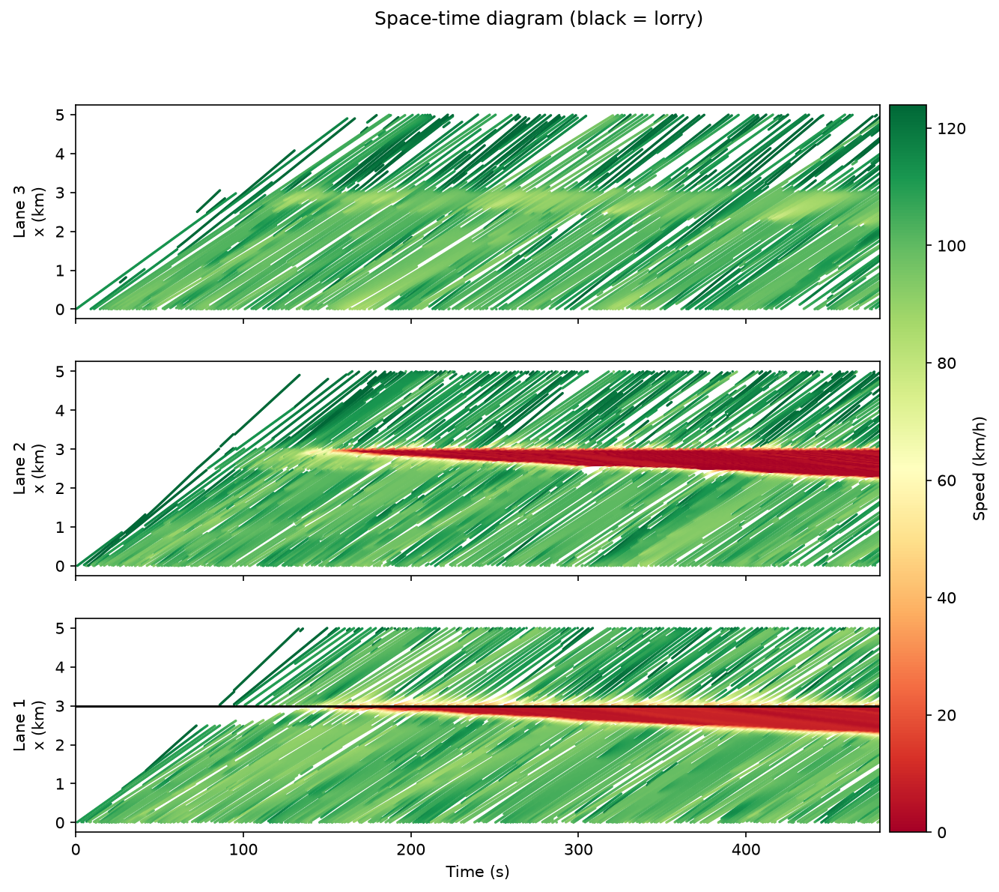

# motorway-flow-sim

Microscopic traffic simulation of a three-lane motorway. Every vehicle is an agent. It follows
the car ahead using the **Intelligent Driver Model (IDM)**, changes lanes using **MOBIL**, and
gets an aerodynamic **slipstream** benefit when it drives close behind a lorry.

From these local rules the classic macroscopic phenomena emerge on their own: a queue behind a
broken-down lorry whose shockwave travels upstream, the capacity drop, and a
two-branch fundamental diagram.



## Quick start

```bash
pip install -r requirements.txt

python scripts/run_simulation.py                       # default: broken-down lorry, headless
python scripts/run_simulation.py --render              # live Pygame view (space = pause)
python scripts/run_simulation.py --config config_moving_lorry.yaml --output output/moving
python scripts/generate_plots.py --config config.yaml  # redraw figures from output/trajectories.csv
pytest
```

Headless runs write `trajectories.csv` (one row per vehicle every `record_interval` seconds) plus
`space_time.png` and `fundamental_diagram.png` to `output/`.

## Scenarios

| File | Lorry | What to look for |
|------|-------|------------------|
| `config.yaml` (= built-in defaults) | Stationary in lane 1 at 3 km | Zipper merge. A red queue grows upstream in lanes 1–2 (the shockwave), and the FD shows the free-flow and congested branches with a capacity drop |
| `config_moving_lorry.yaml` | 12 m/s in lane 1, plus 5% lorry traffic | Moving bottleneck. Drafting platoon in the wake, and lanes 2–3 slow down as overtakers merge |

Every field of `motorway.config.SimConfig` can be set in YAML. Unknown keys and invalid values
(for example `dt > 0.1`) are rejected.

## Model

**Longitudinal: IDM.**

$$\dot v = a\left[1-\left(\frac{v}{v_0}\right)^{4}-\left(\frac{s^*}{s}\right)^2\right],\qquad
s^* = s_0 + \max\!\left(0,\; v\tau + \frac{v\,\Delta v}{2\sqrt{ab}}\right)$$

The model is evaluated for all vehicles at once with NumPy. Positions use the ballistic update.
A vehicle that would roll backwards stops exactly at v = 0 instead. Two hard limits apply:
acceleration is never below −b_max, and if the gap s < 0.5·s₀ the vehicle brakes at full
−b_max.

**Lorry wake (slipstream).** A vehicle within `wake_length` behind a lorry has lower drag. Its
maximum acceleration is multiplied by `1 + wake_accel_gain·w`, and its desired headway τ is
multiplied by `1 − (1 − wake_headway_factor)·w`. The wake strength *w* is
`(v_lorry / v_limit)²`, since drag reduction follows dynamic pressure. It is applied at full
value directly behind the lorry, at half value in the adjacent lanes, and is 0 behind a parked
lorry.

**Lateral: MOBIL.** A driver changes lane when

$$\underbrace{\tilde a_c - a_c}_{\text{own gain}} + p\left[(\tilde a_n - a_n) + (\tilde a_o - a_o)\right] + \text{bias} > \Delta a_{th}$$

and the change is safe: neither the new follower nor the driver must brake harder than `b_safe`.
The bias terms model:
- UK keep-left: an incentive towards lane 1.
- Lane closures: inside `obstruction_lookahead` of a stationary obstacle, drivers get a strong
  incentive to leave the blocked lane and a matching penalty for entering it.

Each driver re-evaluates once per `lane_change_interval`, staggered across drivers, with a
cooldown after each change. Lorries stay in lane 1.

**Zipper merging.** Pure MOBIL deadlocks at a lane closure: a stopped car never finds a gap that
is "safe" by IDM standards in a lane moving at 90 km/h. Two mechanisms prevent this:
- A blocked driver who cannot merge asks the follower in the free lane to yield. That follower
  treats the merging car as its leader, braking at most at its comfortable rate b.
- A follower crawling below 1 m/s is not treated as endangered by a merge.

**Boundaries.** The road is open. Arrivals are Poisson at `inflow` (veh/h), split evenly across
lanes. A vehicle enters at the leader's speed only once the IDM equilibrium gap s₀ + vτ is free;
until then it waits in a per-lane queue (`Simulation.pending`). This is how the capacity limit
shows up at the entry. Vehicles leave the road at `road_length`.

**Driver heterogeneity.** Drivers are aggressive, normal or cautious, drawn by `profile_mix`.
Each driver's desired speed also gets ±5% Gaussian noise. Lorries use a 25 m/s limiter.

## Analytics

- **Space-time diagram:** one panel per lane, coloured by speed. Lorries are drawn in black.
- **Fundamental diagram:** uses Edie's generalised definitions over 250 m × 30 s cells.
  Density k is total time spent divided by area, and flow q is total distance travelled divided
  by area. Both are reported per lane.

## Layout

```
motorway/
  config.py      SimConfig, driver profiles, YAML loader + validation
  road.py        lanes as position-sorted lists; insert/remove/change lane/neighbours
  vehicle.py     Vehicle state, IDM, wake, safety clamp, MOBIL criteria
  simulation.py  time stepper: lane changes -> IDM -> integration -> exits -> inflow -> record
  analytics.py   space-time, Edie fundamental diagram, summaries
scripts/         run_simulation.py (CLI + Pygame renderer), generate_plots.py
tests/           IDM, MOBIL, simulation invariants, Edie on synthetic flow
notebooks/       exploration.ipynb: heterogeneity and lorry-density sweeps
```

## Performance

The default scenario (8 simulated minutes, about 300 vehicles on the road at once) takes 30–80 s
on a laptop. The IDM step is vectorised, while MOBIL and the vehicle bookkeeping run in plain
Python.
